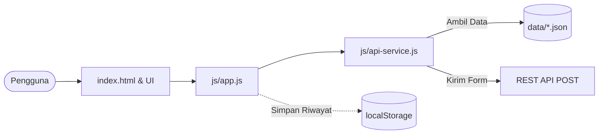

# Laporan Praktikum Pemrograman dan Pengujian Web (12S3101)
## Modul 04: Arsitektur Aplikasi Web (Decoupled Data, Dynamic CSR, & DevTools)

### Identitas Mahasiswa
- **Nama**: Nikah Suchia Panjaitan
- **NIM**: 12S24041
- **Program Studi**: S1 Sistem Informasi
- **Institut**: Institut Teknologi Del
- **Dosen Pengampu**: Chandro Pardede, S.Kom., M.Sc.
- **Branch Git**: `week4-architecture`

---

### 1. Ringkasan Tugas
Pada praktikum minggu ke-4 ini, saya melanjutkan tugas portofolio minggu ke-3 dengan memisahkan data dari tampilan (arsitektur *decoupled*) dan memuat data secara dinamis dari browser (*Client-Side Rendering*):
1. **Pemisahan Data**: Data kartu proyek, layanan konsultasi, dan profil yang sebelumnya ditulis langsung di `index.html` dipindahkan ke file JSON terpisah di folder `data/` (`projects.json`, `services.json`, `profile.json`).
2. **Pemuatan Dinamis**: Menggunakan JavaScript (`fetch()` dan `async/await`) untuk mengambil data JSON lalu menampilkannya ke halaman tanpa reload.
3. **Satu Modal Bersama (Universal Modal)**: Mengganti 4 modal terpisah di minggu ke-3 menjadi 1 modal dinamis (`#universalProjectModal`) yang isinya berganti otomatis sesuai proyek yang diklik.
4. **Variasi Status Tampilan (UI States)**: Menangani 4 kondisi antarmuka: saat memuat (*loading*), saat data berhasil muncul (*success*), saat hasil filter kosong (*empty*), dan saat terjadi error (*error*).
5. **Form Pemesanan Layanan**: Mengirim data formulir lewat HTTP POST ke REST API publik (JSONPlaceholder) dan menyimpan riwayat pemesanan di `localStorage`.
6. **Keamanan Input**: Menambahkan sanitasi string (`escapeHTML` dan pengecekan URL) agar terhindar dari risiko XSS saat merender data dinamis.

---

### 2. Alur Arsitektur Sistem
Aplikasi memisahkan bagian tampilan, logika pengambilan data, dan penyimpanan data agar kode lebih rapi dan teratur (*Separation of Concerns*):



Penjelasan alur kerja:
- **Tampilan (Presentation Tier)**: `index.html` dan `style.css` untuk tata letak visual, serta `app.js` untuk mengatur interaksi kartu, filter, dan modal dinamis.
- **Pengambilan Data (Data Access Layer)**: `api-service.js` bertugas memanggil `fetch()` ke file JSON dan mengirim data form via POST.
- **Penyimpanan Data (Data Tier)**: Berkas `projects.json`, `services.json`, dan `profile.json` di folder `data/`.
- **Penyimpanan Lokal**: Browser menyimpan riwayat pemesanan form di `localStorage`.

---

### 3. Komparasi: Minggu 3 vs Minggu 4

| Bagian | Minggu 3 (Statis) | Minggu 4 (Dinamis / Decoupled) |
|---|---|---|
| **Data Proyek** | Ditulis manual langsung di file `index.html`. | Disimpan terpisah di `data/projects.json` dan dimuat via JavaScript. |
| **Komponen Modal** | 4 modal terpisah ditulis berulang di HTML. | Cukup 1 modal dinamis yang diisi otomatis sesuai ID proyek. |
| **Filter Kategori** | Belum ada fitur filter. | Filter kategori proyek berfungsi langsung tanpa reload halaman. |
| **Formulir Layanan** | Submit form standar yang memicu reload halaman. | Form dikirim lewat HTTP POST asinkron dengan notifikasi Toast. |
| **Riwayat Pesanan** | Hilang saat halaman ditutup atau di-refresh. | Tersimpan di `localStorage` peramban. |
| **Status Tampilan** | Tidak ada status loading atau error. | Ada tampilan loading, data kosong, dan pesan error jika fetch gagal. |

---

### 4. Pengujian Kecepatan & Cache di Browser (DevTools)
Pengujian dilakukan lewat tab **Network** pada Chrome DevTools untuk melihat perbedaan saat website dibuka pertama kali (*Cold Load* / belum ada cache) dan saat dibuka kembali (*Warm Load* / memanfaatkan cache browser):

| Parameter | Cold Load (Cache Mati) | Warm Load (Cache Aktif) | Keterangan & Analisis |
|---|:---:|:---:|---|
| **Status Response** | `200 OK` | `304 Not Modified` / `(disk cache)` | File diambil dari cache laptop tanpa unduh ulang (standar cache HTTP). |
| **Ukuran Transfer** | ~850 KB | ~35 KB | Lebih hemat kuota dan data hingga >90%. |
| **Kecepatan Respon Awal (TTFB)** | ~45 ms | < 15 ms | Respon server dari cache jauh lebih cepat. |
| **Total Waktu Muat (Finish)** | ~780 ms | ~195 ms | Halaman terbuka jauh lebih cepat pada kunjungan kedua. |
| **Waktu Olah HTML (DCL)** | ~280 ms | ~90 ms | Struktur halaman siap lebih cepat karena HTML lebih ringkas. |

---

### 5. Struktur Folder
```text
ppw-2026-week2-12S24041/
├── index.html          # File HTML utama
├── style.css           # File CSS styling
├── README.md           # Laporan dokumentasi tugas
├── data/               # Folder data JSON
│   ├── profile.json    # Biodata mahasiswa
│   ├── projects.json   # Data 4 proyek portofolio
│   └── services.json   # Data paket konsultasi
├── js/                 # Folder kode JavaScript
│   ├── api-service.js  # Fungsi fetch data & kirim POST
│   └── app.js          # Controller antarmuka & modal dinamis
└── assets/             # Aset gambar dan dokumen
    ├── foto-profil.jpg
    └── projects/
        ├── project-01/
        ├── project-02/
        ├── project-03/
        └── project-04/
```

---

### 6. Cara Menjalankan Proyek
1. Buka folder proyek ini di **Visual Studio Code**.
2. Klik kanan pada berkas `index.html` lalu pilih **"Open with Live Server"**.
3. Buka Console dan tab Network (F12) untuk melihat data JSON dimuat dan pengiriman form berjalan.

---

### 7. Tautan Repositori & Live Deployment
- **Repositori GitHub**: [https://github.com/NikahPanjaitan/ppw-2026-week2-12S24041](https://github.com/NikahPanjaitan/ppw-2026-week2-12S24041)
- **Branch**: `week4-architecture`
- **GitHub Pages**: [https://nikahpanjaitan.github.io/ppw-2026-week2-12S24041/](https://nikahpanjaitan.github.io/ppw-2026-week2-12S24041/)