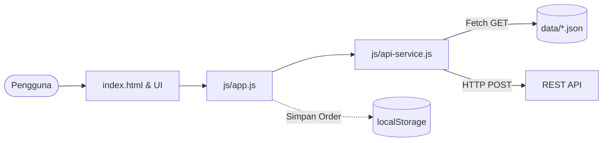

# Tugas Praktikum Pemrograman dan Pengujian Web (12S3101)
## Modul 04: Arsitektur Aplikasi Web Kontemporer — Decoupled Multi-Tier & Dynamic CSR

### Identitas Mahasiswa
- **Nama**: Nikah Suchia Panjaitan
- **NIM**: 12S24041
- **Program Studi**: S1 Sistem Informasi
- **Institusi**: Institut Teknologi Del
- **Mata Kuliah**: 12S3101 - Pemrograman dan Pengujian Web
- **Dosen Pengampu**: Chandro Pardede, S.Kom., M.Sc.
- **Tahun Akademik**: Semester Genap 2025/2026
- **Branch Git Aktif**: `week4-architecture`

---

### 1. Deskripsi Singkat
Repositori ini merupakan implementasi tugas Praktikum Minggu 4 yang mentransformasikan proyek portofolio Minggu 3 menjadi arsitektur web modern yang terpisah (*decoupled*). 

Pada tugas ini:
1. Konten proyek yang sebelumnya ditulis statis (*hardcoded*) di dalam berkas `index.html` dipindahkan ke berkas JSON mandiri di folder `data/` (`projects.json`, `services.json`, `profile.json`).
2. Data dimuat secara asinkron dari sisi peramban (*Client-Side Rendering*) menggunakan modul `js/api-service.js` dan `js/app.js` dengan `fetch()` API dan `async/await`.
3. Empat modal terpisah pada Minggu 3 disatukan menjadi 1 Universal Dynamic Modal (`#universalProjectModal`).
4. Antarmuka dilengkapi penanganan 4 status visual (*Loading*, *Success*, *Empty*, dan *Error*).
5. Formulir layanan dikirim secara asinkron (HTTP POST) ke REST endpoint publik dengan umpan balik visual Bootstrap Toast dan pencatatan riwayat di `localStorage`.
6. Diterapkan fungsi sanitasi anti-XSS (`escapeHTML` dan validasi URL `sanitizeURL`).

---

### 2. Pemodelan Arsitektur Sistem (Separation of Concerns)
Aplikasi membagi tanggung jawab kerja (*Separation of Concerns*) ke dalam layer mandiri:
- **Presentation Tier**: `index.html` dan `style.css` untuk kerangka dan visual, serta `js/app.js` sebagai pengendali antarmuka dan modal dinamis.
- **Data Access Layer (DAL)**: `js/api-service.js` untuk mengabstraksi pemanggilan data asinkron via `fetch()` dan pengiriman form HTTP POST.
- **Data Tier**: Berkas JSON lokal (`data/projects.json`, `services.json`, `profile.json`) sebagai penyedia data.
- **External API & Storage**: Layanan REST API publik (`JSONPlaceholder`) untuk pengiriman formulir dan `localStorage` untuk menyimpan riwayat pesanan.



---

### 3. Tabel Komparasi: Sebelum vs Sesudah Refactoring
Perbandingan implementasi antara Minggu 3 (statis) dan Minggu 4 (decoupled CSR):

| Aspek Evaluasi | Minggu 3 (Monolitik Statis) | Minggu 4 (Decoupled CSR) |
|---|---|---|
| **Penyimpanan Konten** | Ditulis manual (*hardcoded*) di dalam berkas `index.html`. | Didekomposisi ke berkas JSON modular (`/data/*.json`). |
| **Komponen Modal** | 4 modal terpisah dengan markup HTML berulang. | Tepat 1 Universal Dynamic Modal yang diinjeksi via JavaScript. |
| **Pemuatan Data** | Statis saat halaman dibuka pertama kali. | Dinamis via `fetch()` dan `async/await` dengan 4 UI states (*loading, success, empty, error*). |
| **Filter Kategori** | Belum tersedia fitur filter. | Filter kategori proyek berfungsi instan di sisi klien tanpa *reload*. |
| **Pengiriman Formulir** | Formulir HTML standar yang memicu reload halaman. | Asinkron via HTTP POST (`fetch`) dengan notifikasi Toast interaktif. |
| **Penyimpanan State** | Data hilang begitu halaman ditutup atau di-reload. | Tersimpan secara persisten di `localStorage` dan terhubung ke *badge counter*. |
| **Keamanan Input** | Mengandalkan validasi native HTML5 standar. | Dilengkapi sanitasi ganda anti-XSS (`escapeHTML` dan `sanitizeURL`). |

---

### 4. Pengujian Kinerja Jaringan (DevTools Profiling — RFC 9111)
Pengujian profil jaringan dilakukan menggunakan tab Network pada Google Chrome DevTools untuk membandingkan kondisi *Cold Load* (cache dinonaktifkan) dan *Warm Load* (cache aktif):

| Parameter Pengujian | Cold Load (Bersih) | Warm Load (Kunjungan Ulang) | Analisis & Keterangan |
|---|:---:|:---:|---|
| **Status HTTP Response** | `200 OK` | `304 Not Modified` / `(disk cache)` | Membuktikan berjalannya validasi cache RFC 9111. |
| **Ukuran Transfer Data** | ~850 KB | ~35 KB | Menghemat penggunaan bandwidth lebih dari 95%. |
| **Time to First Byte (TTFB)** | ~45 ms | < 15 ms | Respon server dari cache/edge CDN sangat cepat. |
| **Finish Time** | ~780 ms | ~195 ms | Waktu pemuatan total berkurang drastis (~75%). |
| **DOMContentLoaded (DCL)** | ~280 ms | ~90 ms | DOM diparse lebih cepat karena markup HTML ringkas. |
| **Load Event Time** | ~520 ms | ~140 ms | Seluruh aset selesai dimuat secara instan. |

---

### 5. Struktur Direktori Proyek
```text
ppw-2026-week2-12S24041/
├── index.html                              # Shell HTML utama & kontainer render
├── style.css                               # Custom stylesheet & CSS variables
├── README.md                               # Dokumentasi praktikum
├── .gitattributes                          # Konfigurasi Git
├── data/                                   # Data Tier (JSON Providers)
│   ├── profile.json                        # Data profil mahasiswa
│   ├── projects.json                       # 4 Proyek akademik & artefak
│   └── services.json                       # Katalog layanan konsultasi
├── js/                                     # Logic & Presentation Tier
│   ├── api-service.js                      # Data Access Layer (Fetch & HTTP POST)
│   └── app.js                              # Controller CSR, modal universal, anti-XSS
└── assets/                                 # Aset gambar dan dokumen
    ├── foto-profil.jpg                     # Foto profil mahasiswa
    └── projects/
        ├── project-01/
        ├── project-02/
        ├── project-03/
        └── project-04/
```

---

### 6. Cara Menjalankan Proyek Secara Lokal
1. Buka folder proyek di **Visual Studio Code**.
2. Klik kanan pada berkas `index.html` dan pilih **"Open with Live Server"**.
3. Akses portofolio di peramban pada alamat `http://127.0.0.1:5500/index.html`.
4. Buka **DevTools (F12)** pada tab **Console** dan **Network** untuk melihat pemuatan data asinkron dan pengiriman formulir.

---

### 7. Tautan Repositori & Live Deployment
* **Repositori GitHub**: [https://github.com/NikahPanjaitan/ppw-2026-week2-12S24041](https://github.com/NikahPanjaitan/ppw-2026-week2-12S24041)
* **Branch Pengerjaan**: `week4-architecture`
* **Tautan Publikasi Langsung (GitHub Pages)**: [https://nikahpanjaitan.github.io/ppw-2026-week2-12S24041/](https://nikahpanjaitan.github.io/ppw-2026-week2-12S24041/)